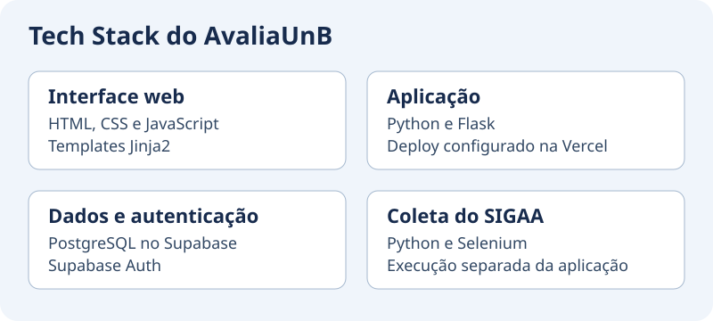

# Diagramas de Arquitetura

Aqui estão as versões mais recentes e atualizadas da arquitetura do projeto AvaliaUnb.

=== "Contexto"

    ### Diagrama de Contexto

    

=== "Componentes da API"

    ### Diagrama de Componentes da API

    

=== "Tech Stack"

    ### Tech Stack

    

    O Flask renderiza as páginas Jinja2. O Supabase hospeda o PostgreSQL e
    gerencia contas e sessões com o Supabase Auth. O scraper coleta o catálogo
    do SIGAA em um processo separado.

## Aprofundamento

Os diagramas mostram as relações gerais. Consulte o [guia do backend](BACKEND.md)
para rotas e repositórios, o [modelo de dados](Modelo%20de%20Dados.md)
para tabelas e RLS, o [scraper](COMO_USAR_SCRAPER.md) para a coleta e
[o mapa da documentação](GUIA_DOCUMENTACAO.md) para os demais temas.
