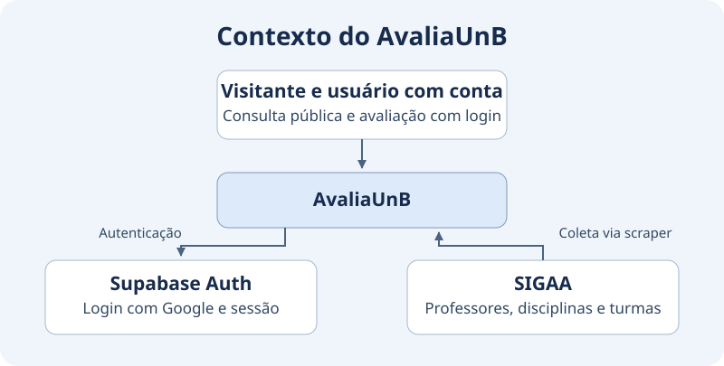
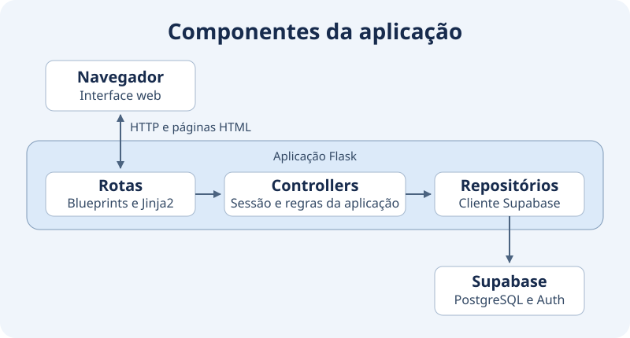
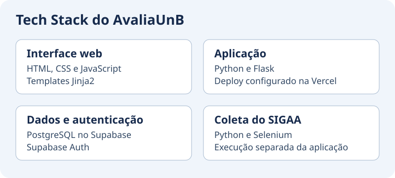

# Diagramas de Arquitetura

Os diagramas representam a arquitetura do AvaliaUnB implementada na `main`.

=== "Contexto"

    ### Diagrama de Contexto

    

    Qualquer visitante pode consultar o catálogo. O registro de notas exige
    login com uma conta Google pelo Supabase Auth. O scraper
    importa professores, disciplinas e turmas do SIGAA.

=== "Componentes da aplicação"

    ### Diagrama de Componentes da Aplicação

    

    As rotas Flask renderizam os templates Jinja2 e delegam as operações aos
    controllers. Os repositórios usam o cliente Supabase para dados e autenticação.

=== "Tech Stack"

    ### Tech Stack

    

    O Flask renderiza as páginas Jinja2. O Supabase hospeda o PostgreSQL e
    gerencia contas e sessões com o Supabase Auth. O scraper coleta o catálogo
    do SIGAA em um processo separado.

## Fluxos confirmados na main

Use este recorte para atualizar o story map e as histórias de usuário no
FigJam. As rotas indicam onde conferir cada comportamento no sistema.

| Atividade | História de usuário | Onde conferir |
|---|---|---|
| Consultar o catálogo | Como visitante, quero buscar professores por nome, disciplina ou departamento e abrir o perfil para ver suas disciplinas e notas. | `/professores` e `/professores/<id>` |
| Comparar professores | Como visitante, quero escolher uma disciplina e comparar as médias nela de dois ou mais professores que a ministram. | `/comparar` |
| Consultar o ranking | Como visitante, quero ver a classificação dos professores elegíveis e abrir seus perfis. | `/ranking` |
| Acessar a conta | Como usuário, quero entrar com a conta Google, criar meu perfil no primeiro acesso e encerrar minha sessão. | `/login`, `/login/google/retorno` e `/logout` |
| Avaliar uma disciplina | Como usuário com conta, quero registrar notas por critério para a disciplina que cursei com o professor. | `/avaliar/<professor_id>` |
| Gerenciar minhas avaliações | Como autor, quero consultar, editar e excluir minhas próprias notas no perfil. | `/perfil` e ações em `/avaliacoes/<id>` |

Cada conta registra uma avaliação em estrelas por combinação de professor e
disciplina. Os detalhes sobre critérios e médias estão no
[guia de funcionalidades](FUNCIONALIDADES.md).

### Revisão final com o FigJam

O [login com Google](https://github.com/unb-mds/2026-2-AvaliaAiUnB/pull/192)
substituiu o acesso local por senha e o fluxo de recuperação de senha. A
migração da [tabela de comentários](https://github.com/unb-mds/2026-2-AvaliaAiUnB/pull/185)
já está no repositório. A conferência final do fluxo de comentários acompanha
a [interface do perfil do professor (#167)](https://github.com/unb-mds/2026-2-AvaliaAiUnB/issues/167).

## Aprofundamento

Os diagramas mostram as relações gerais. Consulte o [guia do backend](BACKEND.md)
para rotas e repositórios, o [modelo de dados](Modelo%20de%20Dados.md)
para tabelas e RLS, o [scraper](COMO_USAR_SCRAPER.md) para a coleta e
[o mapa da documentação](GUIA_DOCUMENTACAO.md) para os demais temas.
