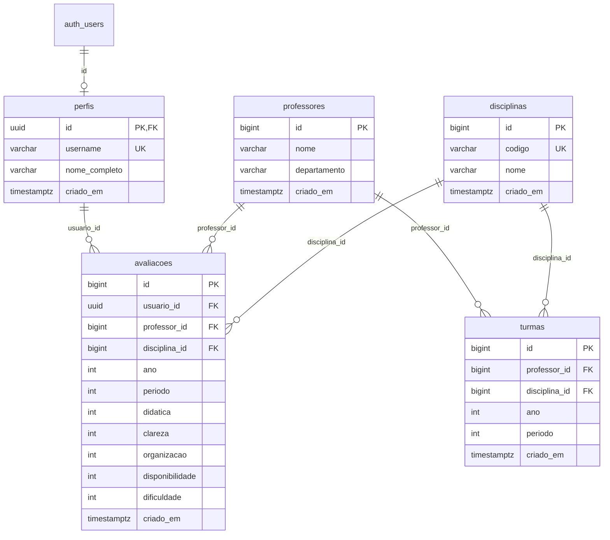

# Modelo de dados do AvaliaUnB (Supabase / PostgreSQL)

> Issue #109. Depende da #90 (esquema versionado em `docs/migrations/`).
> O esquema e as políticas estão versionados em SQL; sua aplicação em cada ambiente deve ser conferida. A tabela de comentários é **apenas proposta**, sem migração aplicada.

## 1. Visão geral

O banco tem cinco tabelas e uma view. Três são alimentadas pelo scraper do SIGAA (`professores`, `disciplinas`, `turmas`) e duas pelos usuários autenticados (`perfis`, `avaliacoes`).



## 2. Tabelas

### 2.1 `professores`

Alimentada pelo scraper do SIGAA.

| Coluna | Tipo | Restrições |
|---|---|---|
| `id` | `BIGINT` | PK, `GENERATED BY DEFAULT AS IDENTITY` |
| `nome` | `VARCHAR(255)` | `NOT NULL` |
| `departamento` | `VARCHAR(255)` | `NOT NULL`, default `''` |
| `criado_em` | `TIMESTAMPTZ` | default `NOW()` |

- **Unicidade:** `uq_professores_nome_departamento` em `(nome, departamento)`.

### 2.2 `disciplinas`

Alimentada pelo scraper do SIGAA.

| Coluna | Tipo | Restrições |
|---|---|---|
| `id` | `BIGINT` | PK, identity |
| `codigo` | `VARCHAR(50)` | `NOT NULL` |
| `nome` | `VARCHAR(255)` | `NOT NULL` |
| `criado_em` | `TIMESTAMPTZ` | default `NOW()` |

- **Unicidade:** `uq_disciplinas_codigo` em `(codigo)`.

### 2.3 `turmas`

Vínculo entre professor e disciplina em um semestre. Alimentada pelo scraper.

| Coluna | Tipo | Restrições |
|---|---|---|
| `id` | `BIGINT` | PK, identity |
| `professor_id` | `BIGINT` | `NOT NULL`, FK → `professores(id)` `ON DELETE CASCADE` |
| `disciplina_id` | `BIGINT` | `NOT NULL`, FK → `disciplinas(id)` `ON DELETE CASCADE` |
| `ano` | `INTEGER` | `NOT NULL` |
| `periodo` | `INTEGER` | `NOT NULL`, `CHECK (periodo BETWEEN 1 AND 4)` |
| `criado_em` | `TIMESTAMPTZ` | default `NOW()` |

- **Unicidade:** `uq_turmas_prof_disc_ano_periodo` em `(professor_id, disciplina_id, ano, periodo)`. É a chave usada pelo scraper para não duplicar turmas.

### 2.4 `perfis`

Dados públicos do usuário, ligados ao Supabase Auth.

| Coluna | Tipo | Restrições |
|---|---|---|
| `id` | `UUID` | PK, FK → `auth.users(id)` `ON DELETE CASCADE` |
| `username` | `VARCHAR(30)` | `NOT NULL` |
| `nome_completo` | `VARCHAR(100)` | `NOT NULL` |
| `criado_em` | `TIMESTAMPTZ` | default `NOW()` |

- **Unicidade:** `uq_perfis_username` em `(username)`.

### 2.5 `avaliacoes`

Avaliação por critérios objetivos, com notas inteiras de 1 a 5.

| Coluna | Tipo | Restrições |
|---|---|---|
| `id` | `BIGINT` | PK, identity |
| `usuario_id` | `UUID` | `NOT NULL`, FK → `perfis(id)` `ON DELETE CASCADE` |
| `professor_id` | `BIGINT` | `NOT NULL`, FK → `professores(id)` `ON DELETE CASCADE` |
| `disciplina_id` | `BIGINT` | `NOT NULL`, FK → `disciplinas(id)` `ON DELETE CASCADE` |
| `ano` | `INTEGER` | `NOT NULL` |
| `periodo` | `INTEGER` | `NOT NULL`, `CHECK (periodo BETWEEN 1 AND 4)` |
| `didatica` | `INTEGER` | `NOT NULL`, `CHECK (1..5)` |
| `clareza` | `INTEGER` | `NOT NULL`, `CHECK (1..5)` |
| `organizacao` | `INTEGER` | `NOT NULL`, `CHECK (1..5)` |
| `disponibilidade` | `INTEGER` | `NOT NULL`, `CHECK (1..5)` |
| `dificuldade` | `INTEGER` | `NOT NULL`, `CHECK (1..5)` |
| `criado_em` | `TIMESTAMPTZ` | default `NOW()` |

- **Unicidade:** `uq_avaliacoes_usuario_prof_disc` em `(usuario_id, professor_id, disciplina_id)`. Cada usuário avalia uma vez cada combinação professor + disciplina. Como `ano` e `periodo` não entram na chave, não é possível reavaliar a mesma combinação em outro semestre.

### 2.6 View `vw_professor_disciplina`

Junta `turmas`, `professores` e `disciplinas` para consulta direta.

| Coluna | Origem |
|---|---|
| `turma_id` | `turmas.id` |
| `professor_id` | `turmas.professor_id` |
| `professor` | `professores.nome` |
| `departamento` | `professores.departamento` |
| `disciplina_id` | `turmas.disciplina_id` |
| `codigo_disciplina` | `disciplinas.codigo` |
| `disciplina` | `disciplinas.nome` |
| `ano` | `turmas.ano` |
| `periodo` | `turmas.periodo` |

Definição (conferida no banco com `pg_get_viewdef`):

```sql
SELECT t.id AS turma_id,
       t.professor_id,
       p.nome AS professor,
       p.departamento,
       t.disciplina_id,
       d.codigo AS codigo_disciplina,
       d.nome AS disciplina,
       t.ano,
       t.periodo
  FROM turmas t
  JOIN professores p ON p.id = t.professor_id
  JOIN disciplinas d ON d.id = t.disciplina_id;
```

> Atenção: por padrão, uma view no PostgreSQL executa com as permissões do dono, não de quem consulta, e por isso pode contornar o RLS das tabelas de base. Hoje isso é aceitável porque as três tabelas são dados públicos do SIGAA. Se a view passar a expor dados sensíveis, usar `WITH (security_invoker = true)` (PostgreSQL 15+).

## 3. Cascatas

| Ao apagar... | Também é apagado |
|---|---|
| `auth.users` | `perfis` → `avaliacoes` do usuário |
| `perfis` | `avaliacoes` do usuário |
| `professores` | `turmas` e `avaliacoes` do professor |
| `disciplinas` | `turmas` e `avaliacoes` da disciplina |

Consequência prática: o scraper não deve apagar professores ou disciplinas para "refazer" a carga, pois isso destrói as avaliações associadas. Deve usar upsert pelas chaves únicas acima.

## 4. Chave de unicidade do professor e efeito nas buscas

O professor é identificado por **(nome, departamento)**, não só pelo nome.

O **departamento** guardado em `professores` é a **unidade que oferece a disciplina** no SIGAA, e não necessariamente o departamento de lotação do docente. Por isso:

- Um mesmo docente que leciona disciplinas ofertadas por departamentos diferentes pode aparecer como **mais de um registro** em `professores`, cada um com seu `id` e suas próprias avaliações.
- Dois docentes homônimos em departamentos diferentes são tratados como pessoas distintas, o que pode estar certo ou errado.
- Uma busca apenas por `nome` pode retornar vários registros para a mesma pessoa. A interface deve exibir o departamento ao lado do nome, e a busca não deve assumir que o nome é único.
- Médias de avaliação são calculadas **por registro**, então um docente dividido em dois registros terá notas separadas.

Limitação conhecida: não existe hoje uma identificação única do docente (como matrícula). Unificar registros duplicados seria uma decisão futura.

## 5. Políticas de RLS

### Esquema versionado e ambiente real

A versão atual de [`001_initial_schema.sql`](migrations/001_initial_schema.sql)
habilita RLS nas cinco tabelas e contém políticas para leitura e operações
de escrita. Isso **substitui** o diagnóstico feito na auditoria de 02/11/2026,
quando o banco inspecionado não tinha políticas. O SQL no Git **não demonstra**
que as políticas já foram aplicadas em cada ambiente Supabase.

| Tabela | Políticas declaradas no SQL versionado | Atenção |
|---|---|---|
| `professores`, `disciplinas`, `turmas` | Leitura pública (`SELECT`) | Escrita prevista para o scraper com chave de serviço |
| `perfis` | Leitura pública e política de gerenciamento com `auth.uid() = id` | A leitura pública inclui `nome_completo` no esquema; revisar privacidade e acesso antes da migração #130 |
| `avaliacoes` | Leitura pública, inserção pelo autor e política de alteração/exclusão pelo autor | A segurança do acesso com token do usuário ainda depende da migração #129 |

A aplicação Flask em `main` ainda cria clientes com `SUPABASE_SERVICE_KEY`.
O papel `service_role` ignora o RLS, portanto as permissões no código Flask
continuam essenciais. A adoção da chave pública e de um token de usuário é
acompanhada nas issues [#124](https://github.com/unb-mds/2026-2-AvaliaAiUnB/issues/124),
[#129](https://github.com/unb-mds/2026-2-AvaliaAiUnB/issues/129) e
[#130](https://github.com/unb-mds/2026-2-AvaliaAiUnB/issues/130).

As políticas atuais da migração são a **base versionada**, não uma comprovação
de isolamento suficiente: antes de migrar perfis, definir exatamente quais
colunas podem ser lidas por visitantes e quais operações podem ser feitas pelo
dono. A issue #130 exige que cada pessoa leia e edite apenas seu próprio perfil,
e por isso a política de leitura pública não atende integralmente ao objetivo.

### Como conferir no Supabase

No SQL Editor do **ambiente correto**, execute:

```sql
SELECT tablename, policyname, roles, cmd, qual, with_check
FROM pg_policies
WHERE schemaname = 'public'
ORDER BY tablename, policyname;

SELECT c.relname, c.relrowsecurity, c.relforcerowsecurity
FROM pg_class c
JOIN pg_namespace n ON n.oid = c.relnamespace
WHERE n.nspname = 'public' AND c.relkind = 'r';
```

Compare o resultado com [o script versionado](migrations/001_initial_schema.sql)
e teste efetivamente os papéis `anon`, `authenticated` e dois usuários
distintos; não use `service_role` como prova de restrição de RLS.

### View `vw_professor_disciplina`

A view reúne somente catálogo público (professores, disciplinas e turmas).
No PostgreSQL, views podem executar com os privilégios do dono por padrão;
isso deve ser considerado ao revisar as concessões e o `security_invoker`.
Caso a view passe a expor dados de usuário, será necessária nova revisão de
permissões. Não altere privilégios em produção sem validar as consultas do
catálogo e as políticas aplicadas no ambiente.

### Relação com a auditoria

O [relatório da auditoria](AUDITORIA_SEGURANCA.md) registra o cenário da data
da inspeção. O [resumo de cibersegurança](CIBERSEGURANCA.md) acompanha o plano
atual. Não trate a ausência de políticas naquele diagnóstico como descrição
do conteúdo atual da migração.

## 6. Proposta: tabela `comentarios`

> **Status: proposta para revisão do grupo. SQL não aplicado.**

### 6.1 Decisões de projeto

| Tema | Proposta | Motivo |
|---|---|---|
| Ligação privada com usuário | `usuario_id` → `perfis(id)` | Garante autoria e permissões. A listagem exibe o nome de usuário sem expor o identificador da conta. |
| Ligação com professor | `professor_id` → `professores(id)`, `NOT NULL` | O comentário é sempre sobre um professor. |
| Ligação com disciplina | `disciplina_id` → `disciplinas(id)`, `NOT NULL` | Todo relato se refere a uma disciplina ministrada pelo professor. |
| Quantidade por usuário | Vários relatos para o mesmo professor e disciplina | Cada comentário é identificado pelo seu próprio ID. |
| Exclusão | `ON DELETE CASCADE` em usuário e professor. `RESTRICT` em disciplina | Preserva o vínculo obrigatório dos relatos existentes. |
| Tamanho do texto | De 2 a 1.000 caracteres após retirar espaços em branco das extremidades | Aceita textos curtos e rejeita campos vazios ou com apenas um caractere. |
| Edição | `atualizado_em` mantido por trigger | Mostra se o comentário foi editado. |
| Visibilidade | `ocultado_em` nulo para comentários publicados e visíveis | A listagem exclui comentários ocultados pela moderação. |
| Reações | Uma linha por conta e comentário, com valor `1` ou `-1` | A interface mostra as contagens separadas e oculta valores iguais a zero. A ordenação considera zero quando não houver votos. |

### 6.2 SQL proposto

```sql
-- PROPOSTA: não aplicar sem aprovação do grupo.

CREATE TABLE IF NOT EXISTS comentarios (
    id BIGINT GENERATED BY DEFAULT AS IDENTITY PRIMARY KEY,
    usuario_id UUID NOT NULL REFERENCES perfis(id) ON DELETE CASCADE,
    professor_id BIGINT NOT NULL REFERENCES professores(id) ON DELETE CASCADE,
    disciplina_id BIGINT NOT NULL REFERENCES disciplinas(id) ON DELETE RESTRICT,
    texto TEXT NOT NULL,
    criado_em TIMESTAMPTZ NOT NULL DEFAULT NOW(),
    atualizado_em TIMESTAMPTZ NOT NULL DEFAULT NOW(),
    ocultado_em TIMESTAMPTZ,
    CONSTRAINT ck_comentarios_texto_tamanho
        CHECK (
            char_length(regexp_replace(texto, '^[[:space:]]+|[[:space:]]+$', '', 'g'))
            BETWEEN 2 AND 1000
        )
);

-- Listagem dos comentários de um professor, do mais recente ao mais antigo
CREATE INDEX IF NOT EXISTS idx_comentarios_professor_criado
    ON comentarios (professor_id, criado_em DESC);

-- Mantém atualizado_em
CREATE OR REPLACE FUNCTION set_atualizado_em()
RETURNS TRIGGER AS $$
BEGIN
    NEW.atualizado_em = NOW();
    RETURN NEW;
END;
$$ LANGUAGE plpgsql;

CREATE TRIGGER trg_comentarios_atualizado_em
    BEFORE UPDATE OF texto, disciplina_id ON comentarios
    FOR EACH ROW EXECUTE FUNCTION set_atualizado_em();

-- Apenas o backend acessa as tabelas com vínculos de conta.
ALTER TABLE comentarios ENABLE ROW LEVEL SECURITY;
REVOKE ALL ON comentarios FROM PUBLIC, anon, authenticated;

CREATE TABLE IF NOT EXISTS comentarios_reacoes (
    comentario_id BIGINT NOT NULL REFERENCES comentarios(id) ON DELETE CASCADE,
    usuario_id UUID NOT NULL REFERENCES perfis(id) ON DELETE CASCADE,
    valor SMALLINT NOT NULL CHECK (valor IN (-1, 1)),
    PRIMARY KEY (comentario_id, usuario_id)
);

ALTER TABLE comentarios_reacoes ENABLE ROW LEVEL SECURITY;
REVOKE ALL ON comentarios_reacoes FROM PUBLIC, anon, authenticated;
```

### 6.3 Pontos para o grupo decidir

1. **Disciplina obrigatória.** O backend valida se a disciplina foi
   ministrada pelo professor ao criar, trocar a disciplina ou aprovar textos
   em revisão. Uma conta pode ter vários relatos na mesma disciplina.
2. **Registros independentes.** Comentários e avaliações por estrelas são
   gravados em tabelas separadas. Cada operação verifica suas próprias
   permissões e campos, independentemente de haver registro na outra tabela.
   A tabela `avaliacoes` admite um registro por conta, professor e
   disciplina, conforme a seção 2.5.
3. **Leitura pública com autoria.** O backend lista comentários visíveis com
   ID do comentário, texto, disciplina, datas, contagens e `perfis.username`.
   A ordenação usa a data da primeira publicação (`criado_em`), a contagem
   de curtidas ou a soma de curtidas e descurtidas, conforme a
   [especificação](COMENTARIOS.md).
   Uma consulta separada, por ID do comentário visível, retorna apenas o
   e-mail de conta verificado cuja divulgação o autor confirmou. O backend
   valida a autorização para o endereço atual e mantém o e-mail fora da
   listagem. O registro dessa confirmação fica privado e será definido na
   implementação do [fluxo de privacidade](COMENTARIOS.md).
4. **Moderação.** A tabela `comentarios` guarda o texto já aprovado. Textos
   que precisam de revisão ficam em uma fila privada separada, inclusive
   revisões de comentários publicados. O modelo de fila, denúncias e decisões
   será detalhado na implementação do [fluxo de moderação](COMENTARIOS.md).

### 6.4 Onde cada regra é aplicada

| Regra | Onde é garantida |
|---|---|
| Disciplina obrigatória | O banco exige `disciplina_id` e o backend valida o vínculo com o professor. |
| Texto de 2 a 1.000 caracteres | O banco verifica o tamanho após retirar os espaços em branco das extremidades. O backend valida antes para devolver mensagem amigável. |
| Só o autor edita ou apaga | O backend compara a sessão com o autor. A `service_role` ignora o RLS. |
| Identidade do autor e de quem reage | O servidor usa a sessão verificada e não aceita `usuario_id` enviado pelo cliente. |
| Uma reação por conta e comentário | A chave primária garante a unicidade. O backend valida comentário visível e autor diferente de quem reage. |
| Filtro antes de publicar ou editar | O backend só grava texto público depois da aprovação automática ou manual. |

## 7. Como recriar o banco

1. Criar um projeto Supabase vazio.
2. No **SQL Editor**, executar o script versionado em `docs/migrations/001_initial_schema.sql` e verificar tabelas e políticas. Não executar blocos de proposta de comentários.
3. Copiar `.env.example` para `.env` e preencher:
   - `SECRET_KEY`: gerar com `python -c "import secrets; print(secrets.token_hex(32))"`.
   - `SUPABASE_URL`: URL do projeto (o código remove sufixos como `/rest/v1`).
   - `SUPABASE_SERVICE_KEY`: chave `service_role` em *Project Settings → API*. É secreta: não commitar e não expor em templates.
   - `FLASK_DEBUG`: `0`, ou `1` somente em desenvolvimento local.
4. Executar o scraper do SIGAA para popular `professores`, `disciplinas` e `turmas`.
5. A tabela `comentarios` só entra depois da aprovação da proposta da seção 6.

Veja também: [guia do backend](BACKEND.md), [guia do scraper](COMO_USAR_SCRAPER.md) e [mapa da documentação](GUIA_DOCUMENTACAO.md).
