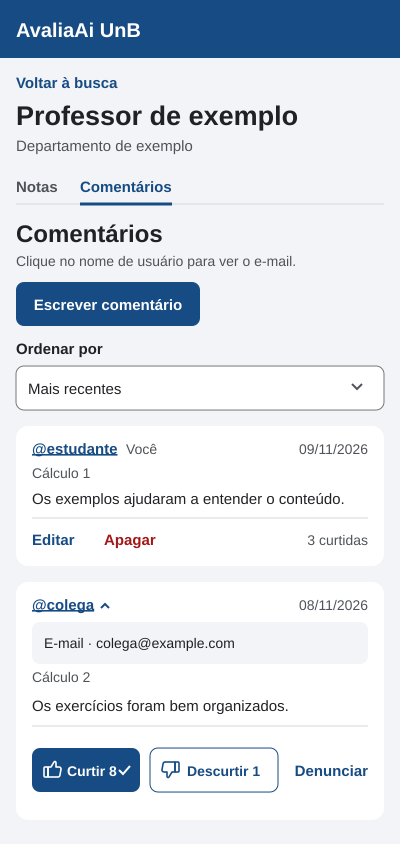
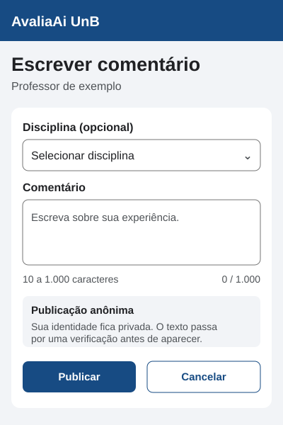
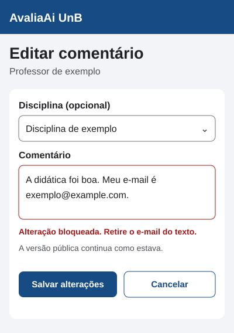
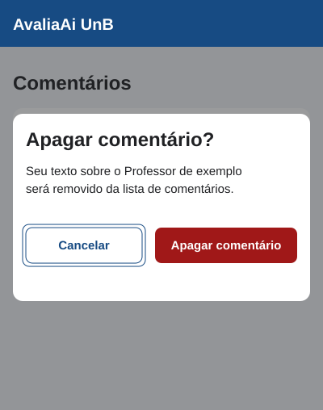

# Telas de comentários

Protótipos da #112 para revisar a experiência em uma tela estreita. Os fluxos
seguem a [especificação da #116](COMENTARIOS.md) e os componentes do
[design system](DESIGN_SYSTEM.md). Os nomes e textos das telas são exemplos.
O perfil do professor oferece as seções **Notas** e **Comentários**. Dar
estrelas e escrever um relato são ações separadas. Quem pode usar as duas
escolhe uma delas ou faz ambas em qualquer ordem. Depois de enviar uma, a
pessoa pode voltar ao perfil e encerrar ou escolher a outra.

## Listar

Visitantes leem os comentários com o nome de usuário do autor, disciplina
e contagens. Clicar, tocar ou ativar o nome pelo teclado abre o e-mail
verificado que o autor autorizou divulgar. Ativar o botão outra vez fecha
o contato. A área convida a entrar ou criar conta com qualquer e-mail
verificado para escrever ou reagir.
A pessoa logada vê **Escrever comentário** se ainda puder publicar naquele
perfil. O exemplo mostra uma conta que já comentou em Cálculo 1 e pode
escrever sobre outra disciplina. Cada relato da própria conta tem as ações
**Editar** e **Apagar**. Na lista vazia, a seção convida a escrever o primeiro
relato.

Os polegares mostram as contagens de **Curtir** e **Descurtir** nos comentários
de outras pessoas. A reação selecionada tem cor e marca de confirmação. É
possível trocar a reação ou desfazê-la com outro toque. Se a sessão não estiver
ativa, tocar no botão leva ao login sem gravar voto.

## Escrever

Para publicar, a pessoa precisa escolher uma disciplina ministrada pelo
professor. Se já tiver um comentário naquela disciplina, a tela oferece a
opção de editá-lo.

O formulário avisa que o nome de usuário fica público e que qualquer pessoa
poderá clicar nele para consultar o e-mail. O autor confirma a divulgação
antes de enviar o texto para verificação. O campo mostra o limite de 2 a
1.000 caracteres. Durante o envio, o botão mostra
**Verificando**. Se o filtro bloquear o texto, a mensagem junto ao campo
explica o que precisa ser revisto e preserva o que foi digitado. Se a análise
precisar de moderação, a confirmação informa **Em revisão** e o texto fica
privado até a decisão.

## Editar

O autor edita o texto e pode trocar a disciplina para outra ministrada pelo
professor em que ainda não comentou. O exemplo mostra uma edição bloqueada
pelo filtro. A última versão aprovada continua visível até uma nova versão
passar pela verificação. Após uma edição aprovada, a lista indica que o
comentário foi editado.

## Apagar

O diálogo identifica a disciplina, avisa que o texto e as reações serão
apagados e oferece Cancelar antes de Apagar comentário. Após confirmar, a
lista é atualizada e o foco retorna a uma ação visível. Em falha, o diálogo
mantém o contexto e permite tentar novamente.

## Denúncia e ocultação

A ação Denunciar abre um formulário com motivo obrigatório e explicação
opcional. A confirmação de recebimento fica visível à pessoa que denunciou.
A identidade de quem enviou a denúncia fica no fluxo privado de moderação.
O autor vê a justificativa quando seu comentário é ocultado e pode pedir revisão
no canal descrito na [especificação](COMENTARIOS.md).
